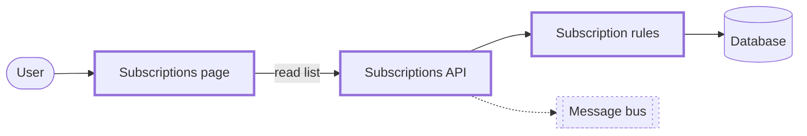

# <Feature Name>, slice <n>: <slice name>

<!--
Written by build-slice after the proof, for the user who decides whether to commit.
One screen. File paths are allowed here: the recap describes this commit, not the future.
-->

## What you can do now

- <The behavior this slice adds, in the user's words>
- <What is still missing and comes in a later slice>

## How it is built

<Two or three sentences: the path a request takes, and the decisions taken that the spec did not prescribe.>

The spec's architecture diagram, with this slice marked. Thick border: added or changed in this slice. Plain: built in an earlier slice. Dotted: planned for a later slice.

- **Differs from the spec**: <nothing | what changed and why; the spec has been updated>

## Proof

| Check | Result |
|-------|--------|
| Slice test (<integration, or UI on stub>): <scenario> | <failed first on: ...; passes now> |
| Unit tests | <n added, all seen failing first, all passing> |
| Verification Commands | <each command: green, zero warnings> |
| AC-<n> | <met: evidence> |
| Verifier (`slice-verifier`) | <PASS, FAIL or INCOMPLETE; each check failed when the behavior was broken: yes, or which did not; what it could not run> |
| Security review (⚠️ slices) | <no findings, or what remains for you to decide> |

## What to review

Read in this order; each line says what to look for.

1. `<path of the slice test>`: <does the scenario match what you expect of the slice?>
2. `<path>`: <the rule or decision that matters most>
3. `<path>`: <the part of a risk area, or the part most likely to be wrong>

## Try it

1. <What to start>
2. <What to open or call>
3. <What you should see>

<Or: nothing to observe by hand, because ...; the slice test is the check.>
<For a stub slice: say that the data is fake and how the stub is switched on.>

## Next

Slice <n+1>: <name>. Commit this slice, recap included, to accept it.
