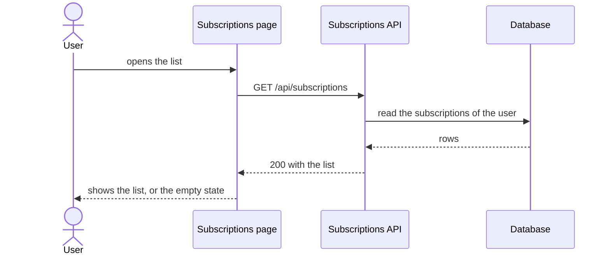
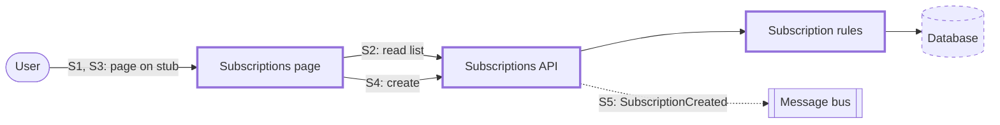

# Spec: <Feature Name>

<!--
The spec is the brief: what must be true when the work is done, how that is checked, and
what it looks like. Leave out file lists, class and test method names, line numbers and
code; whoever builds a slice works those out from the current code. Exception: a contract
that is itself the requirement (a route, a DTO shape, a message name).
Remove the sections the feature does not need. Diagrams and Slices always stay.
-->

## Status

- <date>: branch `<spec branch>` from `<base>`.
- <date>: investigation done. Spec not written.
<!--
The first line names the spec's own branch; all work of this spec is done and committed there.
One line per event, oldest first: spec written, approved by the user, batch mode on, slice N built
(date, proof result, decisions), amended (what and why), amendment approved, shipped.
The state of each slice is in the Slices table. A shipped spec is history: the code is the truth.
-->

## Goal

**As a** <role>, **I want to** <action>, **so that** <benefit>.

<Or, for technical work: the gap, and why closing it matters.>

## Findings

<!-- Written by the investigate skill before the interview. Only what was verified, each with how it is known. -->

- **Reference feature**: `<from CLAUDE.md § Project settings>` <or the feature that is closer, and why>
- **What exists today**: <the behavior and components this feature starts from> (<file read, command run>)
- **What the request depends on**: <schema, API, page, library capability> (<how verified>)
- **Risk areas touched**: <from CLAUDE.md § Project settings, or none>
- **Options considered**: <the approaches that fit the code, and the one chosen with the user, with the reason>

## Constraints

- ⚠️ <Risk area touched and what the user must verify>
- <Invariants and things not to touch>

## Behavior

<What the system does, in the detail this feature needs. Use the sub-headings that apply.>

### Rules

| # | Rule | Error message |
|---|------|---------------|
| BR-1 | ... | "..." |

### Data

| Field | Type | Required | Constraints |
|-------|------|----------|-------------|
| ... | ... | ... | ... |

### API

`<VERB> /api/<route>`: purpose, auth, request and response shape, error responses.

### Events and messages

<Name, trigger, payload summary, effect when consumed.>

### Pages

`/<route>` (authenticated | anonymous): what the user does and sees, step by step; where they go next.

### Edge cases

| Case | Expected behavior |
|------|-------------------|
| ... | ... |

## Diagrams

<!--
Two diagrams, in Mermaid, at component level (never files or classes), at most about
fifteen nodes each. Replace the examples below. They must agree with Behavior and Slices;
when the build changes the architecture, change the diagram.
-->

### What happens

The flow the user or the calling system goes through. Use a sequence diagram for an interaction, a flowchart for a process with decisions, a state diagram for a lifecycle.

### How it is built

The components involved and how data moves between them. Thick border: new. Dashed border: changed. Plain: exists and stays as it is. Each arrow carries the slice that adds it (S1, S2, ...).

## Acceptance criteria

Each criterion names how it is checked: a test at a given level (unit, UI, integration, end to end), an API call and its response, or a page action and its result. The check must fail if the behavior were broken. The tests that prove a criterion carry its id (`AC-1`) in their name or in a trait, tag or comment; ids do not change once the spec is approved.

| # | Criterion | Check |
|---|-----------|-------|
| AC-1 | Given ..., when ..., then ... | Integration test: ... |
| AC-2 | ... | Unit test: ... |

## Slices

Ordered and vertical: each slice is one new piece of functionality the user or the system can perceive, named by what they can do afterwards. ⚠️ marks a slice that touches a risk area. A UI behavior comes as a stub slice (the page on fake data, for the user to try) followed by its wire slice (the real backend from top to bottom). A UI change with nothing to judge on a stub is one slice, and its row says so.

- **Slice test**: the scenario that is written first and decides whether the slice works: an integration test through the real entry point, or for a stub slice a UI test of the page on its stubbed service. Describe the scenario, not a test name.
- **Human check**: the steps the user carries out to see it work, or "none" with the reason.
- **State**: todo, built (proven and verified, recap written, waiting for the user), accepted (committed).

| # | Slice | Criteria | Slice test | Human check | State |
|---|-------|----------|------------|-------------|-------|
| 1 | <User sees the subscription list (stub)> | AC-1 | <UI test: the page on a stub with two subscriptions shows both rows; on an empty stub it shows the empty state> | <Open `/subscriptions` with the stub on: see the two fake rows, judge layout and wording> | todo |
| 2 | <The subscription list shows real data (wire)> | AC-1 | <Integration test: GET the list as a user with two subscriptions: 200 and both returned; as a user with none: 200 and an empty list> | <Open `/subscriptions`, see the two seeded rows> | todo |
| 3 | <User fills in the create form (stub)> | AC-2, AC-3 | <UI test: saving a valid form shows the new row; saving it empty shows the BR-1 message> | <Fill in the form, save, see the new row; save it empty, see the message> | todo |
| 4 | ⚠️ <Creating a subscription is saved (wire)> | AC-2, AC-3 | <Integration test: POST a valid subscription: 201 and it appears in the list; POST without a name: 400 with the BR-1 message> | <Create one, reload the page, see it is still there> | todo |
| 5 | <The list shows the renewal date (single slice: nothing to judge on a stub)> | AC-4 | <Integration test: GET the list: each subscription carries its renewal date, and the page shows it> | <Open `/subscriptions`, see the date column> | todo |

## Out of scope

- ...

## Open questions

- [ ] <Question> <!-- Remove when answered; the answer goes to Behavior, Findings or Status. -->
