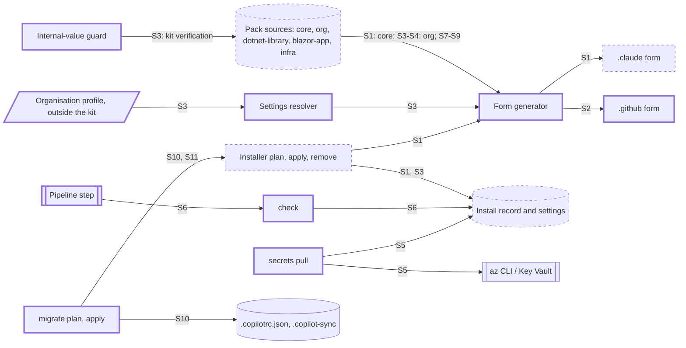

# Spec: Harness packs — one kit for Claude Code and GitHub Copilot across RIZIV/NIHDI

## Status

- 2026-11-19: branch `zyggy/01M7SJAYAREB68GVH3EQHTMG7G` (the job's worktree branch) from `main` at kit 2.1.0. The kit repository has no `CLAUDE.md` § Project settings, so no spec branch name is defined yet (see Open questions).
- 2026-11-19: investigation done from the four source repositories, read-only. Owner decisions of 2026-11-19 recorded under Goal.
- 2026-11-19: spec written as a **draft**. No interview yet, no critic run. **Not approved.** Nothing in the kit (skills, agents, hooks, installer, templates) was changed.

## Goal

**As a** RIZIV/NIHDI team lead, **I want to** set up and keep up to date my repository's AI harness, for Claude Code and for GitHub Copilot, from one kit, **so that** every team works with the same spec-driven workflow and the same operations agents, without hand-kept copies and without Nihdi-Copilot-Sync.

Owner decisions (2026-11-19), fixed:

1. The kit supports both GitHub Copilot (`.github` form) and Claude Code (`.claude` form). One source, two generated forms, no hand-kept duplicates.
2. The operations agents and skills of the devops project (pipeline, DeploymentMap, Dynatrace, kubectl, flux, Sonar and similar) are ported into the kit, so any project team can use them to debug a deploy.
3. The kit takes over everything Nihdi-Copilot-Sync does: init, update without overwriting local edits, the CI check that fails when a repository is behind, and the Key Vault secrets pull.

## Findings

Read in the kit (this repository), Nihdi-Copilot-Sync, devops, Nihdi-Core-Configuration and FindMyDoctor-Wasm. All reads succeeded. Paths below are relative to the repository named.

- **Reference feature**: none defined; the kit has no `CLAUDE.md`. The closest existing behavior is the kit's own installer (`tools/install.mjs`: `plan`, `apply`, `remove`, levels 1–3, hash manifest `.claude/spec-driven.install.json`) and Nihdi-Copilot-Sync's sync pipeline (manifest → token replacement → hash-checked write). (Both read in full.)
- **What exists today, in the kit**:
  - One form only (Claude Code). Kit files are copied verbatim; there is no placeholder or setting mechanism. The version is read from a comment on the first line of the rules file. (`tools/install.mjs`, `.claude/rules/spec-driven.md`)
  - Update without overwriting edits already exists: states `add`, `same`, `update`, `modified`, `collision`, `remove`; line endings are normalised before hashing; `modified` and `collision` are skipped unless `--overwrite`. (`tools/install.mjs`)
  - The kit carries no internal value today: a search for the organisation's names and internal domain suffixes in the kit returns nothing. (grep)
  - No test runner for the kit's own code. The installer is checked by hand with `plan`; the skills by `claude plugin eval`. (README § Testing the kit itself)
- **What exists today, in Nihdi-Copilot-Sync** (a .NET global tool plus a content package; full table in Appendix A.1):
  - Commands `init` (interactive: template, six tokens, masked Sonar token written to a user environment variable, Dynatrace secret mappings seeded), `update` (re-sync; `--force`, `--dry-run`, `--version` as an assertion), `check` (exit 1 when the repository's recorded version is behind the tool's embedded version; advisory probe of the public feed for a newer tool), `secrets pull` (Key Vault via the developer's `az` session into user environment variables; value never printed; `--name`, `--dry-run`). (`src/Nihdi.Copilot.Sync/Commands/*.cs`)
  - Three templates (`BlazorServer-3Tier`, `BlazorWasm-3Tier`, `Library`) plus `shared`; a manifest per folder maps each template file to one or more output paths. Dual write: agents and skills to `.github/…` and `.claude/…` byte-identical; instructions to `.github/instructions/` and `src/.github/instructions/`; a root `CLAUDE.md` that imports the `.github` files. (`templates/**/manifest.json`, repository `CLAUDE.md`)
  - The Claude copies of agents carry Claude tool names, which the repository itself notes are inert for Copilot; instructions get no Claude form at all (no `paths`-scoped rule is written). (repository `CLAUDE.md` § Non-obvious mechanics; manifests)
  - Hash baseline in `.copilot-sync/hashes.json`, meant to be git-ignored per clone; a locally modified file is left and the incoming version written to `.copilot-sync/conflicts/<path>.incoming.<ext>`; no baseline means "treat as modified". Hashes are taken without line-ending normalisation. (`Services/FileSyncer.cs`)
  - `playwright-skill` is embedded but in no manifest, so it never ships. (shared `manifest.json`)
  - Internal values sit in the content package and in the tool's prompts: see Appendix B.
- **What exists today, in the consumer repositories**:
  - **devops** was initialised with the `Library` template, which does not fit a PowerShell/Terraform repository; its own plan `_plans/CopilotKitCleanup.md` deletes 24 .NET files and rewrites 8 more, all listed in `overrides`. That plan also records that the stored hashes did not match even unedited files, so every synced file showed as modified. The operations agents unique to devops (`pipeline-debug`, `flux`, `azure-terraform-devops`, `architect`) and skills (`powershell`, `terraform-style-guide`, `deploymentmap-schema`) live there in one form only, or in a different version per form (the Claude `dynatrace` differs from the Copilot one). `.copilot-sync/hashes.json` is committed. (git ls-files, `.copilotrc.json`, the plan)
  - **Nihdi-Core-Configuration** runs kit 2.1.0 at level 3 **and** Copilot-Sync side by side: kit files are recorded in `.claude/spec-driven.install.json`; Copilot-Sync's hashes and ten `.incoming` conflict files are committed; nine instructions were hand-converted to `.claude/instructions/*.md` and are loaded through a "Read before editing" table in `CLAUDE.md`. (git ls-files, `CLAUDE.md`)
  - **FindMyDoctor-Wasm** runs kit 2.1.0 at level 3 and Copilot-Sync side by side; nine instructions were hand-converted to `.claude/rules/*.md` with a `paths:` list (the same globs as Copilot's `applyTo`), which shows the Claude form of an instruction in use. Its `CLAUDE.md` tells Claude to ignore `.github/AGENTS.md` and the Copilot skills, because Copilot still follows the old plan-based workflow (`planner`, `build-feature`). A Copilot hand-port of an older `write-spec` sits in `.github/skills/`. `.gitignore` excludes `.copilot-sync/`, but `hashes.json` is tracked. (git ls-files, `CLAUDE.md`, `.gitignore`)
  - None of the pipeline templates in devops runs `copilot-sync check`; the "CI check" exists as a command only. (grep in devops `src/`)
- **What the request depends on**:
  - Copilot reads `.github/copilot-instructions.md`, `.github/instructions/*.instructions.md` (`applyTo`), `.github/agents/*.agent.md`, `.github/skills/<name>/SKILL.md` and `.github/prompts/*.prompt.md`: all five are written by Copilot-Sync today and used by the teams. (consumer repositories) Whether Copilot has an equivalent of the kit's PreToolUse guards, and whether it can start a context-free sub-agent, was not verified: see Open questions.
  - Claude Code reads `.claude/rules/*.md` with `paths:` (in use in FindMyDoctor-Wasm), `.claude/agents/*.md`, `.claude/skills/<name>/SKILL.md`, hooks in `.claude/settings.json`. (kit, FindMyDoctor-Wasm)
  - The secrets pull depends on the Azure CLI and the developer's own login; writing a user-level environment variable is a Windows notion. (`Services/KeyVaultReader.cs`, `Commands/PullSecretsCommand.cs`)
  - Node.js on developer machines and pipeline agents: the kit already requires it. (README § Install)
- **Risk areas touched**: none defined for the kit (no Project settings). Proposed in Constraints.
- **Security observations** (no value repeated here):
  - In Nihdi-Core-Configuration, the `SonarProjectKey` token slot of `.copilotrc.json` holds a value shaped like a Sonar user token, committed. The owner should have it checked and rotated; the migration must not carry it over (BR-9).
  - devops `.claude/settings.json` is committed with an allow-list that holds internal identifiers (a subscription id, managed-identity and group object ids, Key Vault names, an internal identity-provider host, an internal storage account). Not a secret, but the kind of value this spec keeps out of packs; it stays in that project and is not ported.
  - Nihdi-Core-Configuration and FindMyDoctor-Wasm commit `.claude/settings.json` with broad allow rules (`Bash(*)`, `PowerShell(*)`, and in one of them `git commit`). The kit only adds `ask` entries and does not remove these; noted for the owner.
- **Options considered**:
  - *Keep Copilot-Sync and add the kit to it as a template* — rejected by decision 3.
  - *Distribute packs as Claude Code plugins* — gives the Claude form only; Copilot has no equivalent; rejected by decision 1.
  - *Extend the kit's Node installer with packs, forms and settings* (chosen, pending approval): it already has the safer update model (line-ending-normalised hashes, recorded per project, nothing written into the repository on conflict), runs where the kit already runs, and needs no .NET tool feed.

## Constraints

- ⚠️ **Secrets**: no secret value in any pack, setting, output, log, command line or file under the project. A setting can hold a reference to a secret (environment variable name, vault, secret name), never its value. The user verifies the secrets slice by hand.
- ⚠️ **Internal values**: no pack source carries an internal host name, URL, subscription or tenant id, object id, vault name, cluster or resource-group name, or token name. All of them become settings (Behavior § Settings). Same verification for every slice that ports content.
- ⚠️ **Deleting project files**: only the migration deletes files, and only files it can prove are unchanged generated output. The user verifies the migration slices.
- The Claude form of the core pack stays byte-identical to kit 2.1.0 (after line-ending normalisation) until a later spec changes the core on purpose. Projects that run the kit today see no change from slice 1.
- The installer keeps its rules: it never runs git, never touches `CLAUDE.md` or `.github/copilot-instructions.md` (project-owned), removes and reorders nothing in `.claude/settings.json`.
- Out of reach of this spec's code: the devops pipeline templates and the source repositories. Changes there are listed as follow-up work for their owners (Out of scope).
- Proposed risk areas for the kit (to confirm in Open questions): secrets handling, writing outside `.claude/` and `.github/`, deleting project files, the hash/update model, internal values.

## Behavior

### Words

- **Item**: one agent, skill (with its supporting files), rule, template, hook or command, written once in the kit's source.
- **Pack**: a named set of items with the settings they need. A pack can include an item whose home is another pack, by reference; the item is still written once.
- **Form**: the shape an item takes for one assistant: `claude` (`.claude/…`) or `copilot` (`.github/…`). A project chooses one or both forms at install.
- **Setting**: a value an item needs that differs per organisation, environment or project. Declared by the pack, filled at install, recorded in the project, rendered into the generated files.
- **Organisation profile**: a file with the organisation-wide setting values (the values every RIZIV/NIHDI team shares). It is kept outside the kit and given to the installer; the kit carries none.

### Packs

| Pack | For | Contains (from Appendix A) | Needs |
|---|---|---|---|
| `core` | Every repository | Today's kit: the workflow rule, `new-feature`, `investigate`, `write-spec`, `build-slice`, `amend-spec`, `bugfix`, `spec-critic`, `slice-verifier`, `spec-reviewer`, the guards and the verification runner, the spec and recap templates. Levels 1–3 and manual skills stay as they are | — |
| `org` (organisation) | Every RIZIV/NIHDI repository | Operations agents: `pipeline-debug`, `buildpipeline-guide`, `deploymentmap-guide` with its reference, `dynatrace`, `kubectl`, `flux`, `sonar-review`, `git` (organisation branching and versioning). The secrets command (Behavior § Secrets) | `core`; the organisation profile |
| `dotnet-library` | .NET libraries and packages | Rules `public-api`, `nuget-packaging`, `tests`; skill `add-public-api`, `fix-violations`; agent `code-analysis` | `core` |
| `blazor-app` | 3-tier Blazor applications | Rules `domain-entity`, `persistence-layer`, `application-layer`, `blazor-presentation`, `refit-client`, `nservicebus`, `logging` (WASM), and per hosting variant `cfe-controller` (WASM) or `bff-controller` (Server); skills `add-blazor-page`, `add-endpoint`, `add-nservicebus`, `configure-nservicebus` (with reference and templates), `configure-hangfire`, `configure-sts`, `database-changes`, `refit`, `e2e-test` (with deployed-environment discovery), `webapp-testing`. Includes `tests`, `fix-violations` and `code-analysis` from `dotnet-library` by reference | `core`; setting `hosting` = `wasm` or `server` |
| `infra` (infrastructure) | Pipeline, Terraform and PowerShell repositories (devops, the Flux repositories) | Agent `azure-terraform-devops`; skills `powershell` (Pester), `terraform-style-guide`; optional MCP server entries for Terraform documentation | `core` |

**Dropped** (not ported; reason in Appendix A): `planner`, `build-feature`, the `new-feature` prompt, the plan template and Copilot-Sync's spec template, the shared `AGENTS.md`, the `bugfix` agent (the core's `bugfix` skill replaces it), the `explore` agent (both assistants have their own), `architect`, `playwright-skill`, the three `COPILOT-GUIDE.md`, the template `CLAUDE.md` files that import `.github`, the Library and .NET leftovers in devops, the hand-ports (`.claude/instructions/*` in Nihdi-Core-Configuration, the Copilot `write-spec` in FindMyDoctor-Wasm). `pdf`, `pptx`, `xlsx`: dropped unless the owner decides otherwise (Open questions).

**Stays in its project**: `deploymentmap-schema` (devops: generates the schema from devops' own classes), devops `CLAUDE.md`, `AGENTS.md`, `MEMORY.md`, `.mcp.json`, `.claude/settings.json` and the Terraform-folder `CLAUDE.md`; Nihdi-Core-Configuration's rules `blazor`, `functional`, `webapi` and its `e2e-test` (TestProject stack); FindMyDoctor-Wasm's `_qa` scenarios; every project's own `CLAUDE.md` and `copilot-instructions.md`.

### One source, two forms

Each item is written once in the kit's source, in the Claude vocabulary, with a frontmatter that is a superset of what both assistants need. The generator writes each form from it. The Claude form of an item is what Claude Code reads; the Copilot form is what Copilot reads; neither is ever edited in the kit.

| Source item | Claude form | Copilot form |
|---|---|---|
| Rule with `paths` | `.claude/rules/<name>.md`, frontmatter `paths:` (list) | `.github/instructions/<name>.instructions.md`, frontmatter `applyTo:` (the same globs, comma-separated) and `description:` |
| Rule without `paths` (always on) | `.claude/rules/<name>.md` | `.github/instructions/<name>.instructions.md` with `applyTo: "**"` |
| Skill (folder) | `.claude/skills/<name>/…` | `.github/skills/<name>/…` (same files) |
| Agent | `.claude/agents/<name>.md`, `tools:` in Claude names | `.github/agents/<name>.agent.md`, `tools:` mapped through the kit's tool table; a tool without a Copilot counterpart is left out and reported |
| Template | `.claude/templates/<name>` | `.github/templates/<name>` |
| Hook, settings fragment, verification runner | `.claude/hooks/…`, merged into `.claude/settings.json` | none: reported as "no Copilot form" (BR-4) |

Inside an item's text, three source constructs are resolved per form; nothing else differs between the forms:

- `{{path:<item>}}`: the path of another item in the current form (for example the workflow rule is `.claude/rules/spec-driven.md` in one and `.github/instructions/spec-driven.instructions.md` in the other).
- `{{setting:<name>}}`: a setting value (Behavior § Settings).
- A form block, `<!-- form:claude -->…<!-- /form -->` or `<!-- form:copilot -->…<!-- /form -->`: text for one form only, for the few places where the assistants work differently (how to start a context-free reviewer: the Agent tool in Claude Code; in Copilot, a new chat with that agent and only the spec path).

The workflow is the same in both forms: Copilot users get the spec-driven workflow, not the retired plan-based one. The guards are enforced only where the assistant has hooks; in the Copilot form they remain instructions (see Open questions).

### Settings

| Field | Type | Required | Constraints |
|---|---|---|---|
| name | text | yes | Dotted, unique across all packs, e.g. `org.dynatrace.environments` |
| role | text | yes | One line saying what the value is; shown when the value is asked or missing |
| scope | `organisation` or `project` | yes | `organisation` values come from the profile by default; `project` values are asked or derived per repository |
| kind | `value`, `list` or `secret-ref` | yes | A `list` holds one entry per environment (TST, VAL, PRD, …) with named fields. A `secret-ref` holds an environment variable name and a source: Key Vault (vault, secret name) or prompt; never a value |
| default | text or rule | no | A value, or a derivation rule (the Sonar project key from the git remote, as Copilot-Sync does today) |

- Values are taken, in this order: a value given on the command line; the value recorded in the project; the organisation profile; the default. A required setting with no value stops the install (BR-2).
- The project records its values in the kit's settings file (`.claude/spec-driven.json`, new `settings` object, per pack). Updates use the recorded values; changing one and running the update re-renders every file the project has not changed (BR-6).
- The kit's own verification fails when any pack source contains a literal internal value: a URL or host name not on the kit's list of public hosts, a GUID, a Key Vault-style or cluster-style resource name, or a token-shaped string (BR-1). The check works on shapes, so it needs no list of internal names.
- Settings that the inventory requires, by role (no values): the Azure DevOps organisation URL and the name of the shared pipeline-template repository; where the live DeploymentMap schema is read; per environment the Dynatrace API base URL and the variable that holds its token; the Sonar server URL, the Sonar token variable and the project key; per environment the AKS cluster, its resource group and subscription; the Flux repositories and their protected branches; the Azure DevOps PAT variable; for `blazor-app` the solution name, namespace root, DbContext name, unit-test executable, hosting variant, local STS and host addresses, and the deployed environments' entry points. Appendix B lists where each of these lives today.

### Commands

The installer stays `node tools/install.mjs <command> <project>`, run from the kit folder. The setup session (`/setup`) remains the guided way to run it; every command also works without a Claude session, so a team that only uses Copilot can install.

| Command | Purpose |
|---|---|
| `plan` | As today, plus packs, forms and settings: per file `add`, `same`, `update`, `modified`, `collision`, `remove`, "no Copilot form"; the settings that would be asked. Writes nothing |
| `apply` | Installs `--packs <list>` in `--forms claude,copilot`, with `--profile <file>` and `--set <name>=<value>`; records packs, forms, settings and hashes |
| `remove` | As today, for every form |
| `check` | Exit 0 when the project's recorded kit version equals the kit's; exit 1 when it is behind, naming both versions and the update command; exit 0 with a warning when it is ahead; exit 2 when the project has no kit record |
| `secrets pull` | Run in the project folder through the command the `org` pack installs; `--name <variable>`, `--dry-run` (Behavior § Secrets) |
| `migrate plan` / `migrate apply` | From Nihdi-Copilot-Sync (Behavior § Migration) |

The kit ships a pipeline step that checks the kit out at its released version and runs `check` on the repository; wiring it into the shared templates is the devops owner's decision (Open questions).

### Secrets

- For each `secret-ref` of source Key Vault, the command reads the secret with the developer's own `az` session and writes it to a user-level environment variable of the referenced name. For source prompt (the Sonar token), it asks with masked input and writes it the same way.
- The value passes through the process only: it is never printed, never logged, never placed on a command line (it reaches the environment writer through standard input or an API), never written to a file under the project or to the settings file.
- Each reference produces one line: the variable name, the vault and secret name, and the outcome (set, would set, failed with a hint). Exit 1 when any failed.
- Supported on Windows, where Copilot-Sync worked. On other systems the command says it is not supported and exits 1 (see Open questions).

### Migration from Nihdi-Copilot-Sync

`migrate plan` reads `.copilotrc.json` and `.copilot-sync/` and writes nothing; `migrate apply` does what the plan showed, after the user's go per decision.

| Copilot-Sync | Becomes |
|---|---|
| `template: Library` | packs `core`, `org`, `dotnet-library`, proposed; the user confirms (devops is the counter-example: there the user picks `infra`) |
| `template: BlazorWasm-3Tier` / `BlazorServer-3Tier` | packs `core`, `org`, `blazor-app` with `hosting` = `wasm` / `server` |
| `tokens` | settings: `SolutionName`, `NamespaceRoot`, `DbContextName`, `TestExePath` to `blazor-app`/`dotnet-library` project settings; `SonarProjectKey`, `SonarServerUrl` to `org` (BR-9 applies) |
| `secrets[]` | `secret-ref` settings of the `org` pack |
| `overrides[]` | files the project owns: never written, recorded as the project's |
| A file Copilot-Sync wrote, unchanged since its baseline (BR-7) | kit-owned: replaced by the pack's output |
| A file Copilot-Sync wrote, changed since, or with no usable baseline | `modified`: left, shown with the diff against the new output; the user keeps it or takes the kit's |
| A file Copilot-Sync wrote that no pack ships (`planner`, `build-feature`, `src/.github/*` unless kept, …) | `retired`: removed when unchanged, kept and listed when changed |
| `.copilot-sync/` (hashes, conflicts), `.copilotrc.json`, the `.gitignore` entry | removed after the plan listed them |
| Kit 2.1.0 files already installed (`.claude/spec-driven.install.json`) | kept; the record gains packs and forms |
| A hand-converted copy of an instruction (`.claude/rules/<layer>.md`, `.claude/instructions/<layer>.md`) | `collision` with the generated rule: shown with the diff; the user decides per file |

After `migrate apply`, `check` passes and nothing of Copilot-Sync remains in the repository.

### Rules

| # | Rule | Error message |
|---|------|---------------|
| BR-1 | No pack source contains a literal internal value (shape check) | "<file>:<line>: <shape> looks like an internal value; make it a setting." |
| BR-2 | A required setting must have a value before anything is written | "Setting <name> (<role>) has no value. Give it with --set <name>=<value> or in the organisation profile." |
| BR-3 | A generated file contains no unresolved `{{…}}` construct | "<file>: unresolved <construct>." |
| BR-4 | An item with no form counterpart is reported, not silently skipped | "<item>: no Copilot form; the rule stays an instruction." |
| BR-5 | No installed file refers to an agent or skill that is not installed | "<file> refers to <item>, which no installed pack provides." |
| BR-6 | Update replaces a generated file only when the project has not changed it since the last install, in every form | (reported as `modified, skipped`) |
| BR-7 | A Copilot-Sync baseline matches when the file equals it with either line ending | — |
| BR-8 | A `secret-ref` accepts a reference only | "Setting <name> holds a reference to a secret, not a value." |
| BR-9 | A value in a non-secret slot that has the shape of a token is not recorded | "<slot> in .copilotrc.json looks like a token. It was not carried over; have it rotated." |

### Edge cases

| Case | Expected behavior |
|---|---|
| Project installed with kit 2.1.0, no packs recorded | Treated as `core`, form `claude`, at its recorded level; `plan` shows every file `same` |
| Same item reached through two packs (`tests` via `dotnet-library` and `blazor-app`) | Written once; recorded once |
| Project changes a setting after install | Unchanged generated files re-rendered; changed ones skipped and listed |
| Form `copilot` removed from a project later | `apply --forms claude` reports the `.github` files as `remove` (unchanged) or `modified` (kept) |
| `.copilot-sync/hashes.json` missing or committed from another clone | No usable baseline: every Copilot-Sync file is `modified`; the user decides from the diffs |
| `az` missing, not logged in, or access denied | That reference fails with a hint; the others still run; exit 1 |
| A `.github/copilot-instructions.md` already exists | Left alone: project-owned. Pack rules go to `.github/instructions/` |
| Organisation profile not given on an update | Recorded values are used; no question asked |

## Diagrams

### What happens

```mermaid
sequenceDiagram
    actor Lead as Team lead
    participant Inst as Installer
    participant Src as Pack sources
    participant Prof as Organisation profile
    participant Proj as Project repository
    actor Dev as Developer
    participant KV as Key Vault
    participant CI as Pipeline
    Lead->>Inst: plan / migrate plan (packs, forms)
    Inst->>Proj: read install record or .copilotrc.json
    Inst-->>Lead: per file add, same, update, modified, retired; missing settings
    Lead->>Inst: apply / migrate apply with --profile and --set
    Inst->>Prof: organisation values
    Inst->>Src: items of the chosen packs
    Inst->>Proj: Claude and Copilot forms, settings, record; unchanged edits left alone
    Dev->>Proj: secrets pull
    Proj->>KV: read with the developer's az session
    KV-->>Proj: value, into a user environment variable only
    CI->>Inst: check on the repository
    Inst-->>CI: exit 1 when behind, else 0
```

### How it is built



## Acceptance criteria

The kit's integration level is: the installer run as a child process against a temporary project folder built from a fixture, with its exit code, output and resulting files checked. Unit level: Node's built-in test runner on one function. Both are established by slice 1.

| # | Criterion | Check |
|---|-----------|-------|
| AC-1 | Given a project with kit 2.1.0 installed at level 3, when `plan` runs with the pack-based kit, then every installed file is `same` and nothing would be written | Integration test: fixture of a 2.1.0 install; `plan` output and exit code; no file changed |
| AC-2 | Given the `core` pack source, when its Claude form is generated, then every file equals kit 2.1.0's file at the same path after line-ending normalisation | Integration test: compare against a frozen copy of the 2.1.0 files |
| AC-3 | Given `apply --forms claude,copilot --packs core`, then each core item has its Copilot counterpart at the path of the form table, and no Copilot file names a `.claude/` path or holds an unresolved construct (BR-3) | Integration test over the generated `.github` tree |
| AC-4 | A rule with `paths` [a, b] becomes `paths: [a, b]` in the Claude form and `applyTo: "a,b"` in the Copilot form; a rule without `paths` gets `applyTo: "**"` | Unit test of the generator |
| AC-5 | An agent's tools are kept in the Claude form and mapped in the Copilot form; a tool without a counterpart is left out and named in `plan` | Unit test of the tool mapping; integration test of the `plan` line |
| AC-6 | Hooks and the settings fragment produce no `.github` file and one "no Copilot form" line each (BR-4) | Integration test |
| AC-7 | Given a generated file changed in the project, in either form, when the kit is updated, then that file is `modified, skipped` and left as is, and unchanged files are replaced (BR-6) | Integration test: install, edit one Claude and one Copilot file, bump the fixture kit version, `apply` |
| AC-8 | Given a pack with a required setting and no value anywhere, when `apply` runs, then nothing is written, the exit code is non-zero and the message is BR-2's | Integration test |
| AC-9 | Given a profile and a `--set` for the same setting, the `--set` value is rendered; the values are recorded; a later `apply` without profile or `--set` renders the same files | Integration test |
| AC-10 | Given a recorded setting changed with `--set`, when `apply` runs, then unchanged files carry the new value and a changed file is skipped and listed | Integration test |
| AC-11 | The kit's verification fails when a pack source holds a non-allow-listed URL or host, a GUID, a vault- or cluster-style name, or a token-shaped string, naming file and line (BR-1); it passes on the shipped sources | Unit tests with one planted example per shape; the guard runs over all pack sources in the kit's verification |
| AC-12 | A `secret-ref` setting given a value instead of a reference is refused with BR-8's message | Integration test |
| AC-13 | Given the `org` pack with a profile, the `dynatrace` agent exists in both forms, per environment with the API base URL and token variable from the settings, and tells the user to fetch tokens with `secrets pull` | Integration test on the rendered agent, both forms |
| AC-14 | Given `org` installed alone with `core`, every operations agent of the Packs table exists in both forms, and no installed file refers to an item that is not installed (BR-5) | Integration test over the pack combinations core+org, core+org+dotnet-library, core+org+blazor-app, core+org+infra |
| AC-15 | Given Key Vault references and an `az` that returns a marker value, when `secrets pull` runs, then each variable is set, the output lists variable ← vault/secret per line, and the marker appears in no output, no command line of a child process and no file under the project | Integration test with a stub `az` on the PATH and a test-scoped environment writer that records the command lines it was given |
| AC-16 | `--dry-run` lists the targets and calls no `az`; `--name` processes one reference; an incomplete reference or a failed read gives a failed line and exit 1 | Integration tests |
| AC-17 | A prompt-sourced secret is read masked, written to the user environment, and absent from the settings file and the output | Integration test with input piped to the prompt |
| AC-18 | `check` exits 1 when the recorded version is behind, naming both versions and the update command; 0 when equal; 0 with a warning when ahead; 2 without a record | Integration tests, one per case |
| AC-19 | The kit's pipeline step fails a pipeline run on a repository whose recorded version is behind, and passes after the update | End to end: a run in a sample repository in Azure DevOps, behind then updated (carried out by the user) |
| AC-20 | Given `dotnet-library`, the library rules, skills and agents of the Packs table are installed in both forms, rendered with the project's settings, and no `blazor-app` item is installed | Integration test |
| AC-21 | Given `blazor-app` with `hosting` = `wasm`, `cfe-controller` and the WASM `e2e-test` are installed and `bff-controller` is not; with `server` the reverse; items shared with `dotnet-library` are written once | Integration test, both variants and with both packs |
| AC-22 | Given `infra`, its agent and skills are installed in both forms and no .NET item is | Integration test |
| AC-23 | Given a fixture shaped like each of the three consumer repositories (anonymised), `migrate plan` writes nothing and shows the proposed packs, the settings from `tokens`, the secret references, and every file as kit-owned, `modified`, project-owned (override), `retired` or `collision`, and lists `.copilot-sync/` and `.copilotrc.json` for removal | Integration tests, one per fixture |
| AC-24 | A file that equals its Copilot-Sync baseline with LF or with CRLF line endings counts as unchanged (BR-7) | Unit test |
| AC-25 | A token-shaped value in a non-secret slot of `.copilotrc.json` is not carried over and is reported by slot name (BR-9) | Integration test with a planted dummy value |
| AC-26 | After `migrate apply`, unchanged files are replaced by pack output, override and modified files are untouched and recorded as the project's, unchanged retired files are gone, changed retired files are listed, `.copilot-sync/`, `.copilotrc.json` and the `.gitignore` entry are gone, and `check` exits 0 | Integration test on each fixture, followed by `check` |

## Slices

Ordered and vertical. ⚠️ marks a slice that touches a proposed risk area. The kit has no user interface, so there are no stub slices: every slice is one slice with an integration test.

| # | Slice | Criteria | Slice test | Human check | State |
|---|-------|----------|------------|-------------|-------|
| 1 | A project installs the core from the pack layout and sees no change (walking skeleton: pack source layout, generator for the Claude form, the kit's test runner) | AC-1, AC-2 | Integration test: on a 2.1.0 fixture, `plan --packs core` reports every file `same`; the generated Claude form equals the frozen 2.1.0 files | Run `plan` against Nihdi-Core-Configuration and FindMyDoctor-Wasm: every kit file `same`, nothing written | todo |
| 2 | A Copilot user gets the spec-driven workflow (Copilot form of the core) | AC-3, AC-4, AC-5, AC-6, AC-7 | Integration test: `apply --forms claude,copilot` into an empty fixture yields the full `.github` counterpart set, no `.claude/` reference in it, one "no Copilot form" line per hook; an edited Copilot file survives an update | In a scratch repository opened in VS Code, Copilot lists the workflow skills and agents; ask it for a new feature and see it start an investigation into `_specs/`, not a plan | todo |
| 3 | ⚠️ A team installs the Dynatrace agent with its organisation's values (settings, organisation profile, internal-value guard, first `org` item) | AC-8, AC-9, AC-10, AC-11, AC-12, AC-13 | Integration test: `apply --packs core,org` without a profile fails with BR-2 and writes nothing; with a profile renders the agent in both forms; a changed setting re-renders it; the guard fails on a planted internal URL | Install into a scratch repository with the real organisation profile; ask the agent in each assistant for TST problems of a known application; read both rendered files and confirm no value appears that is not in the profile | todo |
| 4 | ⚠️ Any team gets the deploy-debugging agents (the rest of `org`: `pipeline-debug`, `buildpipeline-guide`, `deploymentmap-guide`, `kubectl`, `flux`, `sonar-review`, `git`) | AC-14 (AC-11 over the new sources) | Integration test: each pack combination installs, every operations agent is present in both forms, BR-5 finds no dangling reference, the guard passes | In a team repository, paste a failed deploy log to `pipeline-debug`; it names the failing stage and hands over to `deploymentmap-guide` or `kubectl` as today in devops | todo |
| 5 | ⚠️ A developer pulls the operations tokens from Key Vault | AC-15, AC-16, AC-17 | Integration test with a stub `az`: variables set, marker value absent from output, child command lines and project files; dry run calls nothing; failures exit 1 | On Windows, logged in with `az`, run the dry run, then the pull; open a new terminal and see the variables present; scroll the output and find no value | todo |
| 6 | CI fails when a repository's harness is behind | AC-18, AC-19 | Integration test: `check` on fixtures behind, equal, ahead and without record gives 1, 0, 0 with warning, 2 | Add the step to a sample repository's PR pipeline; run it behind (red), update, run again (green) | todo |
| 7 | A library team installs the .NET library pack | AC-20 | Integration test: `core,org,dotnet-library` in both forms; no `blazor-app` item; settings rendered | Install into a scratch copy of Nihdi-Core-Configuration; ask each assistant to add a public method and see the `public-api` rule applied | todo |
| 8 | A Blazor team installs the Blazor application pack | AC-21 | Integration test: both hosting variants, alone and with `dotnet-library`; shared items written once | Install into a scratch copy of FindMyDoctor-Wasm; open a controller file and see the `cfe-controller` rule loaded in each assistant | todo |
| 9 | An infrastructure team installs the infrastructure pack | AC-22 | Integration test: `core,org,infra` in both forms; no .NET item | Install into a scratch copy of devops; ask for a Pester test and see the `powershell` skill used | todo |
| 10 | ⚠️ A Copilot-Sync repository sees its migration plan | AC-23, AC-24, AC-25 | Integration test on three anonymised fixtures: `migrate plan` writes nothing and classifies every file; a CRLF-only difference counts as unchanged; a planted token-shaped value is refused | Run `migrate plan` on clean clones of devops, Nihdi-Core-Configuration and FindMyDoctor-Wasm; check the classification against `git log` of a few files | todo |
| 11 | ⚠️ A Copilot-Sync repository is migrated | AC-26 | Integration test on the three fixtures: `migrate apply` then `check` exits 0, project-owned and modified files untouched, Copilot-Sync state gone | On a branch of one consumer repository, run `migrate apply`, review the diff, open the repository in both assistants and use one workflow skill and one operations agent | todo |

## Out of scope

- Changing the core workflow itself (skills, agents, hooks, templates): the core is moved, not rewritten. A later spec can change it.
- Wiring the pipeline step into the devops shared templates, and rotating any value named under Security observations: work for their owners.
- Running the migration on every team repository: slice 11 proves it on one; the roll-out is the teams' work.
- Retiring the Nihdi-Copilot-Sync tool and package (unlisting, archiving the repository) after the roll-out.
- Porting devops' project-specific items (`deploymentmap-schema`, its `CLAUDE.md` constraints) and the hand-written `CLAUDE.md` catalogues in the consumer repositories.
- Linux and macOS support for `secrets pull` (unless the owner decides otherwise).

## Open questions

Ordered by how much the answer changes the work. Each has a recommendation.

- [ ] **Where does the organisation profile live, and who maintains it?** It holds every organisation-wide value (Appendix B) and must not be in the kit. *Recommendation*: a file in an internal repository the platform team owns (the devops repository is the natural home, next to the pipeline templates it describes), versioned, read by path at install.
- [ ] **Render values into the generated files, or let the items read them from the settings file at run time?** Rendering puts internal values into many files of each project (as Copilot-Sync does today); reading at run time keeps them in one file but makes every item depend on that file. *Recommendation*: render at install, as Copilot-Sync does; the project repositories are internal, and rendered items work without a lookup step in both assistants.
- [ ] **Copilot and the guards.** The guards (no edit on a protected branch, no recap while verification fails, no file-changing git in review agents) are Claude Code hooks. *Recommendation*: accept that the Copilot form states them as instructions only, say so in the README, and revisit when Copilot offers a pre-tool hook; verify the current state of Copilot when slice 2 is built.
- [ ] **Context-free reviewers in Copilot.** The workflow relies on agents started without the conversation. *Recommendation*: the Copilot form tells the user to open a new chat with the reviewing agent and only the spec path; verify during slice 2 whether Copilot can start a sub-agent itself, and use that if it can.
- [ ] **Where do Copilot users find the Project settings?** They are in `CLAUDE.md`, which the kit does not own. *Recommendation*: keep them in `CLAUDE.md` as the single place and have the Copilot form of the workflow rule point there; do not duplicate them into `.github`.
- [ ] **Where does the kit keep its state for a Copilot-only team?** Today `.claude/spec-driven.json` and `.claude/spec-driven.install.json`. *Recommendation*: keep both under `.claude/` for both forms; moving them breaks the hooks of every project that runs the kit today.
- [ ] **Distribution of the kit.** Copilot-Sync came from a NuGet feed as a .NET tool; the kit is a cloned folder. *Recommendation*: a clone of the kit repository at a release tag, for people and for the pipeline step (as a repository resource); no package feed.
- [ ] **Incoming copies on conflict.** Copilot-Sync wrote `.incoming` files into the repository, and two repositories committed them. *Recommendation*: do not write them; `plan` shows the diff of each `modified` file instead.
- [ ] **`src/.github/` copies of the instructions.** Copilot-Sync writes every instruction twice. *Recommendation*: drop the second copy, after one team using Visual Studio confirms Copilot there reads the root `.github/`.
- [ ] **`pdf`, `pptx`, `xlsx` skills.** Generic document skills, written for .NET libraries. *Recommendation*: drop; teams that need them use the assistants' own document skills.
- [ ] **BlazorServer-3Tier.** No inventoried repository uses it. *Recommendation*: keep the `server` variant in `blazor-app`, but port and prove `wasm` first; drop `server` if no team claims it before slice 8.
- [ ] **Secrets pull outside Windows.** *Recommendation*: Windows only, as today; a Linux or macOS user exports the variables by hand from the dry-run list.
- [ ] **The kit's own Project settings.** The kit has no `CLAUDE.md`: no spec branch name, risk areas or test levels. *Recommendation*: add them before slice 1 (spec branch `feature/<short-name>` from `main`; the risk areas in Constraints; the integration and unit levels of Acceptance criteria), and rename this spec's branch accordingly.
- [ ] **Version scheme.** Copilot-Sync repositories record versions such as `1.0.0` and `7.1.0.0`; the kit uses three-part versions. *Recommendation*: packs share the kit's version; `check` compares three-part versions and treats a Copilot-Sync record as "no kit record" until migrated.

## Appendix A — Inventory

Verdict: **as is** (usable unchanged), **after generalising** (internal values or project names become settings, or the text is cut loose from one project), **project-specific** (stays in its project), **obsolete** (not ported). Internal values are never repeated here; Appendix B names the files.

### A.1 Nihdi-Copilot-Sync

`T/` = `src/Nihdi.Copilot.Customizations/templates/`; `S/` = `src/Nihdi.Copilot.Sync/`.

| Name | Kind | Path | One line | Verdict | Depends on |
|---|---|---|---|---|---|
| bugfix | agent | `T/shared/agents/bugfix.agent.md` | Regression test first, at most two files, escalates to planner | obsolete (core `bugfix` skill) | planner |
| buildpipeline-guide | agent | `T/shared/agents/buildpipeline-guide.agent.md` | Set up and inspect Azure DevOps build pipelines; two-repository pattern; REST API for builds and logs | after generalising | Azure DevOps organisation URL, PAT variable, shared template repository |
| code-analysis | agent | `T/shared/agents/code-analysis.agent.md` | Fix StyleCop, Roslyn, CA/SA/CS warnings; can call sonar-review | as is | fix-violations, sonar-review |
| deploymentmap-guide | agent | `T/shared/agents/deploymentmap-guide.agent.md` | Create and validate DeploymentMap.json for AKS, databases, Service Bus, Keycloak | after generalising | its reference file, live schema location, environment names |
| deploymentmap-guide.reference | agent reference | `T/shared/agents/deploymentmap-guide.reference.md` | Schema details loaded by the guide | after generalising | devops schema |
| dynatrace | agent | `T/shared/agents/dynatrace.agent.md` | Debug deployed apps through Dynatrace problems, events and log search | after generalising | per-environment API URL and token variable, secrets pull, Playwright fallback |
| explore | agent | `T/shared/agents/explore.agent.md` | Read-only codebase exploration | obsolete (built into both assistants) | — |
| git | agent | `T/shared/agents/git.agent.md` | Organisation branching, PRs, tags, hotfixes, versioning | after generalising | branch model, GitVersion |
| kubectl | agent | `T/shared/agents/kubectl.agent.md` | Read-only diagnosis on private AKS clusters | after generalising | az, kubectl, corporate network, per-environment cluster, resource group, subscription |
| planner | agent | `T/shared/agents/planner.agent.md` | Writes `_plans/<Feature>.md` with Red-Green-Refactor steps | obsolete (kit workflow) | plan template |
| sonar-review | agent | `T/shared/agents/sonar-review.agent.md` | Runs dotnet-sonarscanner and groups findings | after generalising | Sonar server URL, token variable, project key |
| domain-entity | instruction | `T/shared/instructions/domain-entity.instructions.md` | Domain entity conventions | after generalising | 3-tier layout |
| nservicebus | instruction | `T/shared/instructions/nservicebus.instructions.md` | Events, messages, handlers | after generalising | Nihdi.Core.Configuration NServiceBus |
| persistence-layer | instruction | `T/shared/instructions/persistence-layer.instructions.md` | EF Core repositories and configurations | after generalising | DbContext name |
| tests | instruction | `T/shared/instructions/tests.instructions.md` | MSTest, AAA, Moq, integration factory | after generalising | solution name |
| new-feature | prompt | `T/shared/prompts/new-feature.prompt.md` | Planner then build-feature | obsolete | planner, build-feature |
| build-feature | skill | `T/shared/skills/build-feature/SKILL.md` | Executes plan steps with layer code templates | obsolete (kit `build-slice`) | `_plans/` |
| configure-hangfire | skill | `T/shared/skills/configure-hangfire/SKILL.md` | Hangfire topology, registration, dashboard, jobs | after generalising | Nihdi.Core.Configuration Hangfire |
| configure-nservicebus | skill | `T/shared/skills/configure-nservicebus/SKILL.md`, `REFERENCE.md` | NServiceBus setup, DeploymentMap side, bridges | after generalising | Nihdi.Core.Configuration NServiceBus, DeploymentMap |
| configure-sts | skill | `T/shared/skills/configure-sts/SKILL.md` | Local STS claims and clients | after generalising | local STS addresses |
| database-changes | skill | `T/shared/skills/database-changes/SKILL.md` | DACPAC tables, columns, procedures | as is | SQL project |
| fix-violations | skill | `T/shared/skills/fix-violations/SKILL.md` | Quick fixes for SA/CA/CS/MSTest warnings | as is | analyzer set |
| pdf | skill | `T/shared/skills/pdf/SKILL.md` | PDFsharp/QuestPDF | obsolete (pending Open question) | — |
| playwright-skill | skill | `T/shared/skills/playwright-skill/**` | Generic Playwright automation (Node) | obsolete (in no manifest, never shipped) | Node Playwright |
| pptx | skill | `T/shared/skills/pptx/SKILL.md` | PowerPoint via OpenXml/python-pptx | obsolete (pending Open question) | — |
| refit | skill | `T/shared/skills/refit/SKILL.md` | Refit clients for Server and WASM | after generalising | Nihdi.Core.Configuration Blazor helpers |
| webapp-testing | skill | `T/shared/skills/webapp-testing/SKILL.md` | .NET Playwright tests of the running app | after generalising | local addresses |
| xlsx | skill | `T/shared/skills/xlsx/SKILL.md` | ClosedXML/EPPlus/openpyxl | obsolete (pending Open question) | — |
| plan-template | template | `T/shared/templates/plan-template.md` | Plan file format | obsolete | planner |
| spec-template | template | `T/shared/templates/spec-template.md` | Older spec format | obsolete (kit template) | — |
| AGENTS.md | guide | `T/shared/AGENTS.md` | Agent catalogue and plan-based workflow | obsolete | planner |
| CLAUDE.md (×3) | guide | `T/<template>/CLAUDE.md` | Root file importing the `.github` files | obsolete | `.github` form |
| COPILOT-GUIDE.md (×3) | guide | `T/<template>/COPILOT-GUIDE.md` | Long user guide per template | obsolete (kit README) | — |
| copilot-instructions.md (×3) | instruction | `T/<template>/copilot-instructions.md` | Always-on instructions per template | project-specific (seeds the project's own file at most) | tokens |
| application-layer (×2) | instruction | `T/BlazorServer-3Tier/…`, `T/BlazorWasm-3Tier/instructions/application-layer.instructions.md` | Commands, queries, handlers, `Result<T>` | after generalising | — |
| blazor-presentation (×2) | instruction | `T/Blazor*/instructions/blazor-presentation.instructions.md` | ViewModels, pages, MudBlazor, localisation | after generalising | — |
| refit-client (×2) | instruction | `T/Blazor*/instructions/refit-client.instructions.md` | Refit client and XSRF pipeline | after generalising | — |
| bff-controller | instruction | `T/BlazorServer-3Tier/instructions/bff-controller.instructions.md` | BFF controllers and handlers (Server) | after generalising | — |
| cfe-controller | instruction | `T/BlazorWasm-3Tier/instructions/cfe-controller.instructions.md` | Cfe host controllers (WASM) | after generalising | — |
| logging | instruction | `T/BlazorWasm-3Tier/instructions/logging.instructions.md` | Log levels, PII ban, WASM forwarding | after generalising | — |
| nservicebus (WASM) | instruction | `T/BlazorWasm-3Tier/instructions/nservicebus.instructions.md` | Same subject as the shared one, template copy | obsolete (duplicate of shared) | — |
| add-blazor-page (×2) | skill | `T/Blazor*/skills/add-blazor-page/SKILL.md` | New page, dialog, ViewModel | after generalising | solution name |
| add-endpoint (×2) | skill | `T/Blazor*/skills/add-endpoint/SKILL.md` | New endpoint through the layers | after generalising | solution name |
| e2e-test (×2) | skill | `T/Blazor*/skills/e2e-test/SKILL.md` | Local and deployed browser tests from `_qa/` | after generalising | local and deployed addresses |
| nuget-packaging | instruction | `T/Library/instructions/nuget-packaging.instructions.md` | MSBuild packaging, GitVersion, SourceLink | as is | — |
| public-api | instruction | `T/Library/instructions/public-api.instructions.md` | XML docs, sealed, guards, deprecation | as is | — |
| add-public-api | skill | `T/Library/skills/add-public-api/SKILL.md` | New public type with tests and docs | after generalising (refers to the old human-gate workflow) | solution name |
| manifests | config | `T/manifest.json`, `T/*/manifest.json` | Registry and source → output maps | obsolete (pack manifests) | — |
| init | CLI command | `S/Commands/InitCommand.cs` | Interactive setup, tokens, Sonar token, Dynatrace mappings | after generalising (into `apply` and `/setup`) | git remote, user environment |
| update | CLI command | `S/Commands/UpdateCommand.cs` | Re-sync with conflict detection | after generalising (into `apply`) | hash model |
| check | CLI command | `S/Commands/CheckCommand.cs` | Exit 1 when behind; advisory feed probe | after generalising (into `check`) | version record |
| secrets pull | CLI command | `S/Commands/PullSecretsCommand.cs`, `S/Services/SecretSyncService.cs`, `KeyVaultReader.cs`, `EnvironmentVariableWriter.cs` | Key Vault to user environment variables, value never printed | after generalising (into `secrets pull`) | az CLI, Windows user environment |
| hash and conflict model | service | `S/Services/FileSyncer.cs` | SHA-256 baseline, `.incoming` copies | obsolete (kit model) | — |
| token replacement | service | `S/Services/TokenReplacer.cs` | Literal `{{Key}}` replacement | after generalising (settings resolver) | — |
| Sonar key derivation | service | `S/Services/SonarProjectKeyResolver.cs`, `GitRemoteReader.cs` | Project key from the Azure DevOps remote | after generalising (setting default rule) | git remote |
| version currency | service | `S/Services/VersionService.cs` | Embedded version vs recorded; public feed probe | after generalising | — |
| tests | tests | `src/Nihdi.Copilot.Sync.Tests/**` | Smoke, mirror, consistency, secrets, resolver tests | obsolete (scenarios carried into the kit's ACs) | — |
| pipelines | CI | `azure-pipeline-dev.yml`, `-main.yml`, `-pr.yml` | Build and pack via devops templates | obsolete | devops |
| pptx (repo's own) | skill | `.github/skills/pptx/SKILL.md` | The repository's own deck skill | project-specific | — |
| blog posts, deck, plans, specs | docs | `BLOGPOST*.md`, `*.pptx`, `_plans/`, `_specs/`, `evolution/` | History and communication | project-specific | — |

### A.2 devops

| Name | Kind | Path | One line | Verdict | Depends on |
|---|---|---|---|---|---|
| pipeline-debug | agent | `.github/agents/pipeline-debug.agent.md` (Copilot only) | Diagnose pipeline failures from pasted logs; delegates to the guides | after generalising | deploymentmap-guide, buildpipeline-guide, devops task names |
| flux | agent | `.claude/agents/flux.md` (Claude only) | Flux/GitOps diagnosis and change support on AKS | after generalising | Flux repositories and their protected branches, kubeconfig per cluster, devops `_docs/Flux.md` |
| kubectl | agent | `.claude/agents/kubectl.md` | Copy of the shared agent | obsolete (from A.1) | — |
| dynatrace | agent | `.claude/agents/dynatrace.md`, `.github/agents/dynatrace.agent.md` | Copies that differ between the two forms | obsolete (from A.1) | — |
| deploymentmap-guide (+reference) | agent | `.claude/agents/…`, `.github/agents/…` | Copies, the Copilot one edited locally | obsolete (from A.1; local edits reviewed at migration) | — |
| buildpipeline-guide | agent | `.github/agents/buildpipeline-guide.agent.md` | Copy of the shared agent | obsolete (from A.1) | — |
| azure-terraform-devops | agent | `.claude/agents/azure-terraform-devops.md`, `.github/agents/…` | Terraform with UMIs, RBAC, Keycloak clients, least privilege | after generalising | terraform-style-guide, Terraform MCP |
| architect | agent | `.claude/agents/architect.md`, `.github/agents/…` | Generic solution-architecture review | obsolete (the kit's investigate covers it) | — |
| planner | agent | `.claude/agents/planner.md`, `.github/agents/…` | Plan-based workflow, rewritten for Pester | obsolete | — |
| bugfix, explore, git, code-analysis, sonar-review | agent | `.github/agents/*.agent.md` | Library-template copies | obsolete (from A.1) | — |
| powershell | skill | `.github/skills/powershell/SKILL.md` | PowerShell 7, Pester, modules, classes, Azure auth | after generalising (names "DevOps") | Pester runner command |
| terraform-style-guide | skill | `.github/skills/terraform-style-guide/**` | HashiCorp style and Azure Verified Modules rules | after generalising (vendored; check its licence before porting) | — |
| deploymentmap-schema | skill | `.github/skills/deploymentmap-schema/**` | Generate the schema from devops' own classes | project-specific | devops source |
| e2e-test | skill | `.claude/skills/e2e-test/SKILL.md` | Library-template copy with an unrendered solution name | obsolete | — |
| Library leftovers | instruction, skill | `.github/instructions/*`, `src/.github/**`, `.github/skills/{add-public-api,build-feature,configure-*,database-changes,fix-violations,pdf,pptx,refit,webapp-testing,xlsx}` | .NET guidance that does not fit this repository | obsolete | — |
| prompt and templates | prompt, template | `.github/prompts/new-feature.prompt.md`, `.github/templates/*` | Plan-based workflow, rewritten locally | obsolete | — |
| AGENTS.md, CLAUDE.md, MEMORY.md, `.github/AGENTS.md`, `.github/copilot-instructions.md`, COPILOT-GUIDE.md | guide | repository root, `.github/` | The repository's own instructions and constraints | project-specific (COPILOT-GUIDE obsolete) | — |
| Terraform folder guide | guide | `src/Deploy/Utilities/Terraform/CLAUDE.md` | Terraform conventions for this repository | project-specific | — |
| DeploymentMap validation guide | guide | `src/Deploy/Shared/DeploymentMapValidation/CLAUDE.md` | Schema rules | project-specific (source for deploymentmap-guide) | — |
| `.mcp.json` | config | repository root | Terraform MCP server (container) and a documentation MCP server | after generalising (optional `infra` entry) | container runtime, an API key variable |
| `.claude/settings.json` | config | `.claude/settings.json` | Permission allow-list with internal identifiers | project-specific (see Security observations) | — |
| Copilot-Sync state | config | `.copilotrc.json`, `.copilot-sync/hashes.json` (committed) | Library template, overrides | obsolete (migration) | — |
| Flux and DeploymentMap docs | docs | `_docs/Flux.md`, `_docs/DeploymentMapConfigurationGuide.md` | Background the agents link to | project-specific (linked by repository name setting) | — |
| Kit cleanup plan | docs | `_plans/CopilotKitCleanup.md` | Evidence of the Library misfit and the hash mismatch | project-specific (history) | — |

### A.3 Nihdi-Core-Configuration

| Name | Kind | Path | One line | Verdict | Depends on |
|---|---|---|---|---|---|
| kit 2.1.0 core | rules, skills, agents, hooks, templates | `.claude/rules/spec-driven.md`, `.claude/skills/{new-feature,investigate,write-spec,build-slice,amend-spec,bugfix}`, `.claude/agents/{spec-critic,slice-verifier,spec-reviewer}.md`, `.claude/hooks/*`, `.claude/templates/*` | Installed by the kit, recorded in `.claude/spec-driven.install.json` | as is (becomes `core`) | `.claude/spec-driven.json` |
| Copilot-Sync agents, Claude copies | agent | `.claude/agents/{buildpipeline-guide,code-analysis,deploymentmap-guide(+reference),dynatrace,explore,git,kubectl,sonar-review}.md` | Mirrors of A.1 | obsolete (replaced by pack output; edits reviewed at migration) | — |
| Copilot-Sync agents, Copilot form | agent | `.github/agents/*.agent.md` (incl. bugfix, planner) | Library-template output | obsolete | — |
| hand-converted instructions | rule | `.claude/instructions/{domain-entity,nservicebus,nuget-packaging,persistence-layer,public-api,tests}.md` | Claude copies of A.1 instructions, loaded via a table in `CLAUDE.md` | obsolete (generated rules replace them); `domain-entity` and `persistence-layer` point at folders this library does not have | — |
| blazor, functional, webapi | rule, instruction | `.claude/instructions/{blazor,functional,webapi}.md`, `.github/instructions/{blazor,functional,webapi}.instructions.md` | This library's own package conventions | project-specific (candidates to become path-scoped rules in the project) | — |
| Copilot-Sync skills | skill | `.claude/skills/{add-public-api,configure-*,database-changes,fix-violations,pdf,pptx,refit,webapp-testing,xlsx}`, `.github/skills/*` | Library-template output, both forms | obsolete (pack output) | — |
| configure-hangfire, configure-nservicebus | skill | `.claude/skills/configure-{hangfire,nservicebus}/` | Locally extended: this repository owns the libraries they describe | after generalising (the source of truth for the `blazor-app` versions) | — |
| e2e-test | skill | `.claude/skills/e2e-test/SKILL.md`, `.github/skills/e2e-test/SKILL.md` | TestProject and WasmTestProject stack | project-specific | — |
| Copilot-Sync leftovers | prompt, template, guide | `.github/prompts/new-feature.prompt.md`, `.github/templates/*`, `.github/skills/build-feature/`, `.github/AGENTS.md`, `COPILOT-GUIDE.md`, `src/.github/instructions/*` | Plan-based workflow | obsolete | — |
| Copilot-Sync state | config | `.copilotrc.json`, `.copilot-sync/hashes.json`, `.copilot-sync/conflicts/**` (all committed) | Template, tokens, overrides; ten `.incoming` files | obsolete (migration; one token slot flagged) | — |
| CLAUDE.md | guide | repository root | Project instructions, Project settings, an artefact catalogue | project-specific (catalogue becomes stale after migration) | — |
| settings | config | `.claude/settings.json`, `.claude/spec-driven.json` | Permissions, guard hooks, verification commands | project-specific (kit entries kept) | — |

### A.4 FindMyDoctor-Wasm

| Name | Kind | Path | One line | Verdict | Depends on |
|---|---|---|---|---|---|
| kit 2.1.0 core | rules, skills, agents, hooks, templates | as in A.3 | Installed by the kit | as is (becomes `core`) | `.claude/spec-driven.json` |
| layer rules, Claude form | rule | `.claude/rules/{application-layer,blazor-presentation,cfe-controller,domain-entity,logging,nservicebus,persistence-layer,refit-client,tests}.md` | Hand-converted from the `.github` instructions, with `paths:` | obsolete (generated by `blazor-app`; proof of the Claude form) | — |
| layer instructions, Copilot form | instruction | `.github/instructions/*.instructions.md`, `src/.github/instructions/*` | BlazorWasm-3Tier output | obsolete (pack output) | — |
| add-nservicebus | skill | `.claude/skills/add-nservicebus/`, `.github/skills/add-nservicebus/` | Events, messages, handlers for this solution; not in Copilot-Sync | after generalising (into `blazor-app`) | solution name |
| configure-nservicebus templates | skill file | `.claude/skills/configure-nservicebus/TEMPLATES.md` (+ Copilot copy) | Code templates not in Copilot-Sync | after generalising | — |
| e2e-test deployed environments | skill file | `.claude/skills/e2e-test/DEPLOYED-ENVIRONMENTS.md` (+ Copilot copy) | How to find deployed entry points from the DeploymentMap (holds no address) | after generalising (solution name) | DeploymentMap |
| other Copilot-Sync skills | skill | `.claude/skills/{add-blazor-page,add-endpoint,configure-hangfire,configure-sts,database-changes,e2e-test,fix-violations,refit,webapp-testing}`, `.github/skills/*` | BlazorWasm-3Tier output, both forms | obsolete (pack output; edits reviewed at migration) | — |
| Copilot-Sync agents | agent | `.claude/agents/{buildpipeline-guide,code-analysis,deploymentmap-guide(+reference),dynatrace,git,sonar-review}.md`, `.github/agents/*` | Mirrors of A.1 | obsolete (pack output) | — |
| write-spec, Copilot hand-port | skill | `.github/skills/write-spec/SKILL.md` | Older kit `write-spec` for Copilot (flat spec files) | obsolete (generated Copilot form of `core`) | — |
| Copilot-Sync leftovers | prompt, template, guide | `.github/prompts/new-feature.prompt.md`, `.github/templates/spec-template.md`, `.github/skills/build-feature/`, `.github/AGENTS.md`, `COPILOT-GUIDE.md` | Plan-based workflow for Copilot | obsolete | — |
| Copilot-Sync state | config | `.copilotrc.json` (with Dynatrace secret references), `.copilot-sync/hashes.json` (tracked despite `.gitignore`), `.copilot-sync/conflicts/**` | Template, tokens, secrets | obsolete (migration) | — |
| QA scenarios | scripts | `_qa/*.mjs` | Named e2e scenarios | project-specific | e2e-test |
| CLAUDE.md, copilot-instructions.md | guide | repository root, `.github/` | Project instructions; tells Claude to ignore the Copilot workflow | project-specific (that note becomes obsolete after migration) | — |

## Appendix B — Where internal values live today

Named by file and role only.

| File | Role of the value |
|---|---|
| Nihdi-Copilot-Sync `README.md` (token map) and `S/Commands/InitCommand.cs` (default answer) | Sonar server URL |
| Nihdi-Copilot-Sync `S/Commands/InitCommand.cs` (default answer), `T/shared/agents/dynatrace.agent.md` | Key Vault name holding the Dynatrace tokens; secret and variable names per environment |
| `T/shared/agents/dynatrace.agent.md` | Dynatrace API base URLs per environment; an Entra group placeholder |
| `T/shared/agents/kubectl.agent.md` | Cluster, resource-group and subscription placeholders; the network path to private clusters |
| `T/shared/agents/buildpipeline-guide.agent.md` | Azure DevOps organisation URL; the PAT variable names (two spellings) |
| `T/shared/agents/deploymentmap-guide.agent.md`, `.reference.md` | URLs, the live schema location, per-environment names |
| `T/shared/agents/sonar-review.agent.md` | Sonar server, token variable |
| `T/shared/skills/configure-sts/SKILL.md`, `T/Blazor*/skills/e2e-test/SKILL.md`, `T/shared/skills/webapp-testing/SKILL.md` | Local and deployed application addresses |
| `T/shared/skills/configure-nservicebus/*`, `configure-hangfire/SKILL.md`, `T/shared/instructions/tests.instructions.md`, `T/shared/templates/plan-template.md`, `T/*/COPILOT-GUIDE.md`, `T/shared/AGENTS.md`, `T/shared/agents/planner.agent.md` | Addresses or URLs in examples (to be reviewed one by one when ported) |
| `.copilotrc.json` in devops, Nihdi-Core-Configuration, FindMyDoctor-Wasm | Sonar server URL; Sonar project key (in one repository the slot holds a token-shaped value); Key Vault name and secret names |
| devops `AGENTS.md` | Platform Key Vault name and the organisation's resource naming patterns |
| devops `.claude/settings.json` | Subscription id, object ids, vault and storage names, identity-provider host (in permission rules) |
| devops `.claude/agents/flux.md` | Cluster names and Flux repository branches |

Found by a pattern search (URLs, GUIDs, vault-style and cluster-style names, token variable names); each hit is classified by role when its item is ported, and the BR-1 guard proves none is left.
